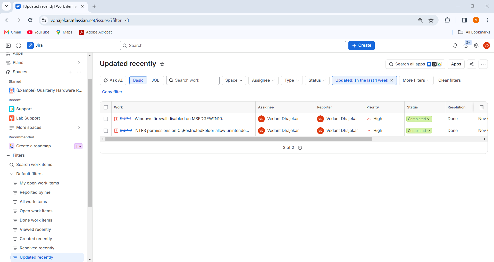
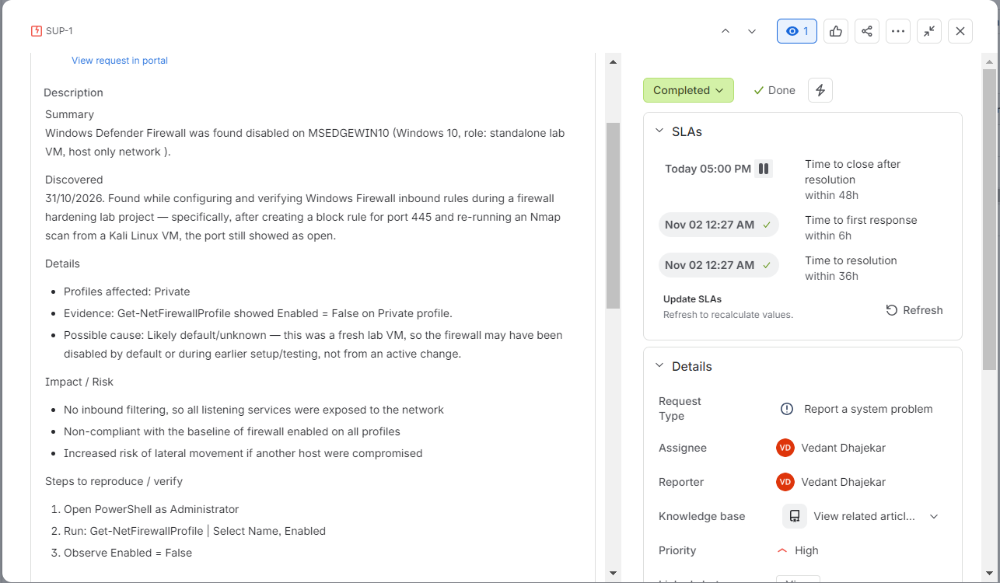
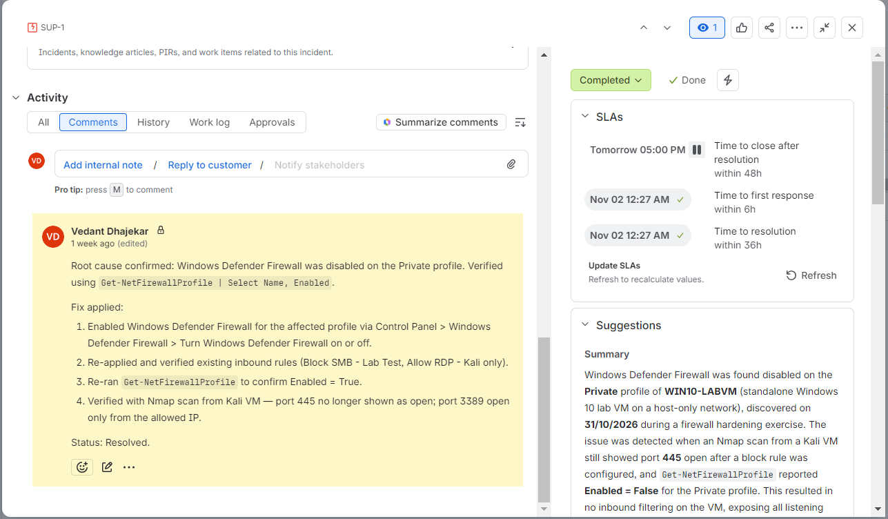
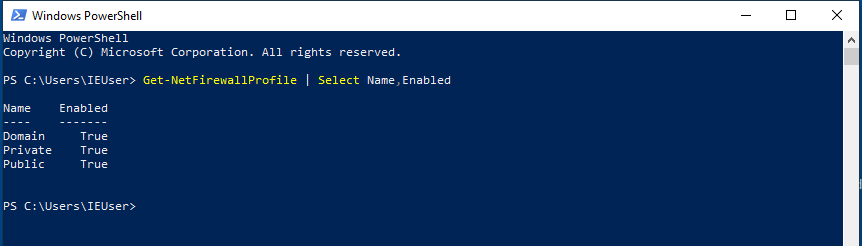
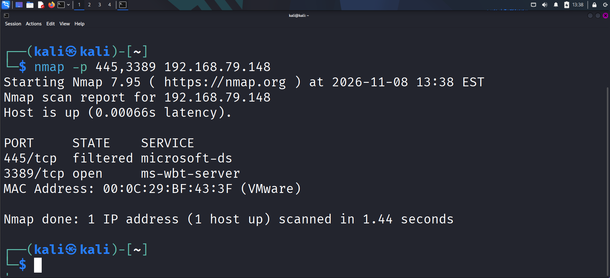
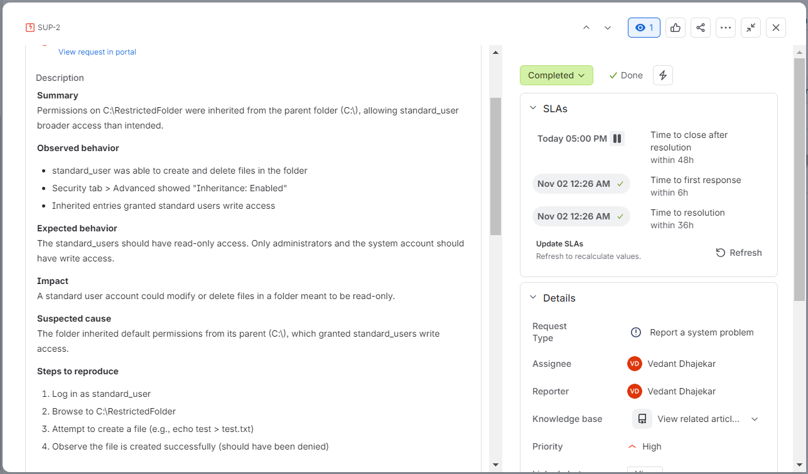
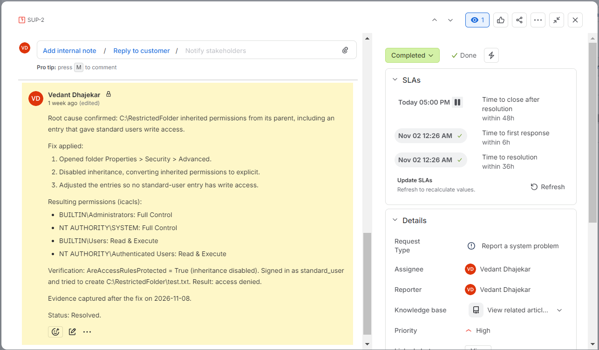
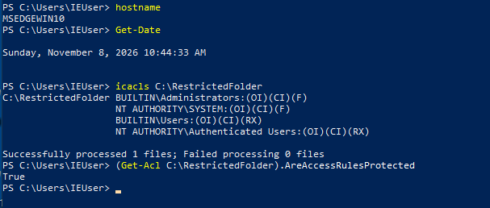
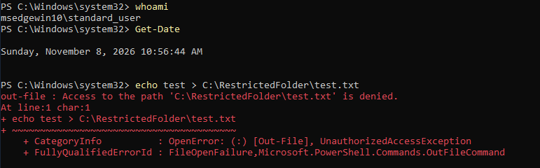

# Helpdesk Ticketing Lab

I logged, triaged, and resolved two real issues from my home lab using **Jira Service Management (free tier)**. Each ticket followed the same workflow: report, assign, investigate, fix, verify, document.

## Environment

- **Target machine:** WIN10-LABVM (Windows 10)
- **Test machine:** Kali Linux VM
- **Tools:** PowerShell, Windows Defender Firewall, NTFS permissions (Security tab / icacls), Nmap
- **Ticketing:** Jira Service Management, "Report a system problem" request type, with SLA tracking

## Ticket Summary

| Key   | Issue                                                        | Priority | Status    |
|-------|--------------------------------------------------------------|----------|-----------|
| SUP-1 | Windows Firewall disabled on WIN10-LABVM                     | High     | Completed |
| SUP-2 | NTFS permissions on C:\RestrictedFolder allow unintended inherited access | High | Completed |

*Figure 01: upport queue with both tickets resolved.*

---

## SUP-1: Windows Firewall disabled

**Problem:** Windows Defender Firewall was disabled on the Private profile of WIN10-LABVM, leaving listening services exposed to the network.

**Root cause:** The firewall profile was turned off. [Add how it happened, e.g. disabled during earlier testing, or write "unknown".]

**Fix:**
1. Re-enabled Windows Defender Firewall for the affected profile (Control Panel > Windows Defender Firewall > Turn Windows Defender Firewall on or off).
2. Re-applied and verified the existing inbound rules (Block SMB - Lab Test, Allow RDP - Kali only).
3. Re-ran `Get-NetFirewallProfile | Select Name, Enabled` to confirm `Enabled = True`.

**Verification:** An Nmap scan from the Kali VM showed port 445 no longer open, and port 3389 open only from the allowed IP.

*Figure 02: SUP-1 as logged: summary, description and status.*

*Figure 03: Resolution comment with root cause, fix steps and verification.* 

*Figure 04a: `Get-NetFirewallProfile` output showing all three profiles `Enabled = True`.Captured after the fix, 2026-11-08.* 

*Figure 04b: Nmap scan from the Kali VM: port 445 filtered, port 3389 open to the Kali host. Captured after the fix, 2026-11-08.*

---

## SUP-2: Unintended inherited NTFS write access

**Problem:** `standard_user` could create and delete files in `C:\RestrictedFolder`, a folder meant to be read-only for standard users.

**Root cause:** The folder inherited permissions from its parent (`C:\`), including an entry that gave standard users write access.

**Fix:**
1. Opened folder Properties > Security > Advanced.
2. Disabled inheritance, converting inherited permissions to explicit.
3. Adjusted the entries so no standard-user entry has write access.

**Resulting permissions (from `icacls`):**

| Principal | Access |
|-----------|--------|
| BUILTIN\Administrators | Full Control |
| NT AUTHORITY\SYSTEM | Full Control |
| BUILTIN\Users | Read & Execute |
| NT AUTHORITY\Authenticated Users | Read & Execute |

**Verification:** `AreAccessRulesProtected` returned `True` (inheritance disabled). Signed in as `standard_user` and tried to create a file in the folder. Result: access denied.

*Pre-fix behavior was observed directly during testing. The screenshots below were captured after the fix on 2026-11-08.*

*Figure 05: SUP-2 as logged: summary, observed behavior, expected behavior and impact.* 

*Figure 06: Resolution comment listing the fix, the resulting permissions and the verification.*

*Figure 07a: `icacls` output and `AreAccessRulesProtected = True` on `C:\RestrictedFolder`, confirming inheritance is disabled. Captured after the fix, 2026-11-08.* 

*Figure 07b: `standard_user` trying to create a file and receiving "Access denied". Captured after the fix, 2026-11-08.*

---

## What I Learned

- Writing the root cause and verification steps forced me to retrace exactly what I did.
- Inherited permissions can silently override a restriction you think is in place, so check the effective access, not just the explicit entries.
- A fix isn't done until it's tested from the affected user's or attacker's side (Nmap, a login as the restricted user).
- SLA tracking showed me why response and resolution times matter in a real helpdesk.
- [Add one honest line of your own.]

## Notes

All hostnames and accounts are from an isolated home lab. Screenshots were cropped to remove personal details.